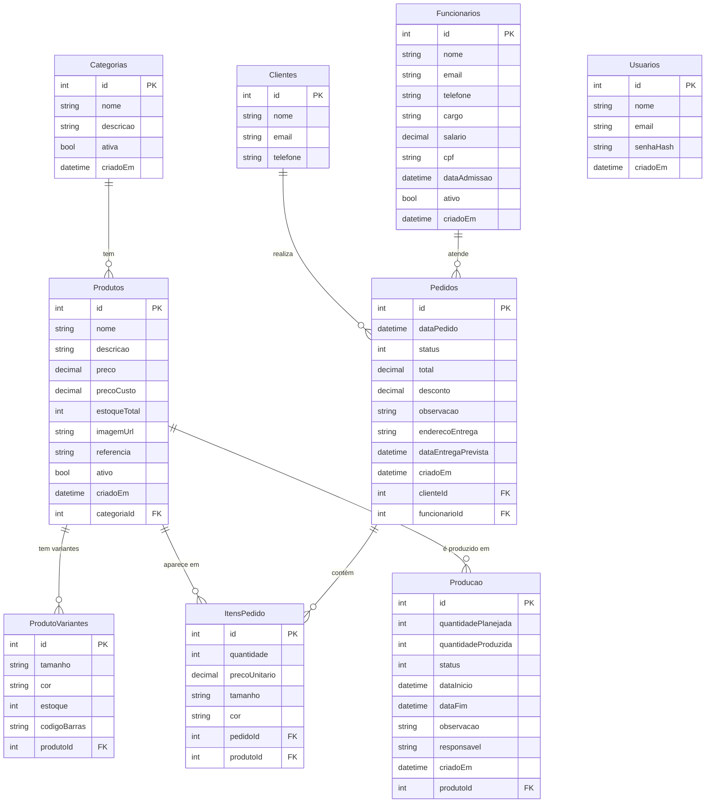
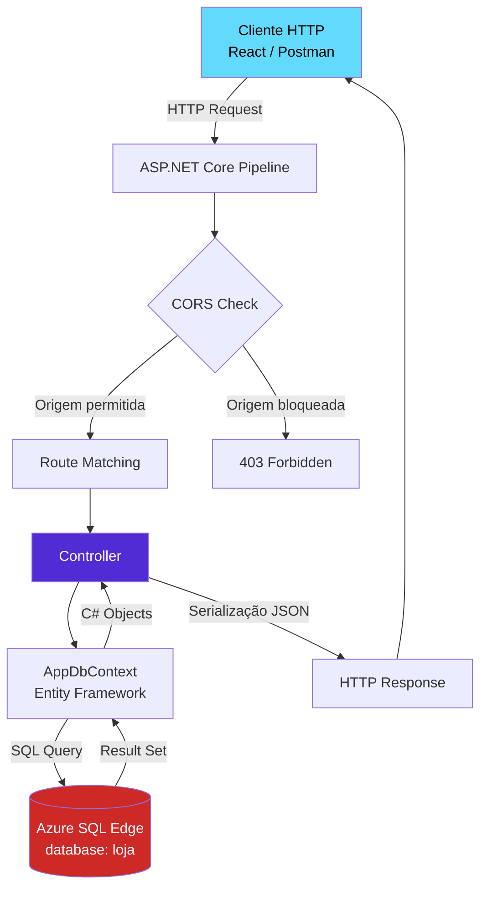

# Documentação da API — StyleStore

API RESTful construída em **ASP.NET Core 8** conectada ao **SQL Server (Azure SQL Edge)** via Entity Framework Core 8.  
Banco de dados: `loja`.

---

## Sumário

- [Arquitetura](#arquitetura)
- [Base URL](#base-url)
- [Tabela de Endpoints](#tabela-de-endpoints)
- [Controllers](#controllers)
  - [Categorias](#categorias)
  - [Produtos](#produtos)
  - [Clientes](#clientes)
  - [Funcionários](#funcionários)
  - [Pedidos](#pedidos)
  - [Produção](#produção)
  - [Usuários](#usuários)
- [Enums de Status](#enums-de-status)
- [Diagrama do Banco de Dados (ER)](#diagrama-do-banco-de-dados-er)
- [Fluxo de uma Requisição](#fluxo-de-uma-requisição)
- [Respostas Padrão](#respostas-padrão)

---

## Arquitetura

```
┌──────────────────┐        HTTP/REST        ┌──────────────────────┐
│   Front-end      │ ──────────────────────► │   API .NET Core 8    │
│ React + Vite     │ ◄────────────────────── │   Controllers        │
│ :5173            │         JSON            │   :5067              │
└──────────────────┘                         └──────────┬───────────┘
                                                        │ Entity Framework Core 8
                                                        │ (SqlServer)
                                             ┌──────────▼───────────┐
                                             │  Azure SQL Edge       │
                                             │  Docker :1433         │
                                             │  database: loja       │
                                             └──────────────────────┘
```

- O front-end faz chamadas para `/api/*` que o Vite redireciona (proxy) para `http://localhost:5067`
- A API usa CORS liberado para `http://localhost:5173` e `http://localhost:3000`
- Referências circulares no JSON são resolvidas com `ReferenceHandler.IgnoreCycles` + `[JsonIgnore]` nas navegações inversas

---

## Base URL

| Ambiente    | URL                         |
|-------------|-----------------------------|
| Local       | `http://localhost:5067`     |
| Swagger UI  | `http://localhost:5067/swagger` |

Todos os endpoints começam com `/api/[controller]`.

---

## Tabela de Endpoints

| Método   | Rota                          | Controller        | Descrição                          |
|----------|-------------------------------|-------------------|------------------------------------|
| GET      | /api/categorias               | Categorias        | Lista todas as categorias          |
| GET      | /api/categorias/{id}          | Categorias        | Retorna categoria com seus produtos|
| POST     | /api/categorias               | Categorias        | Cria nova categoria                |
| PUT      | /api/categorias/{id}          | Categorias        | Atualiza categoria                 |
| DELETE   | /api/categorias/{id}          | Categorias        | Remove categoria                   |
| GET      | /api/produtos                 | Produtos          | Lista produtos com categoria e variantes |
| GET      | /api/produtos/{id}            | Produtos          | Retorna produto com categoria e variantes |
| POST     | /api/produtos                 | Produtos          | Cria novo produto                  |
| PUT      | /api/produtos/{id}            | Produtos          | Atualiza produto                   |
| DELETE   | /api/produtos/{id}            | Produtos          | Remove produto                     |
| GET      | /api/clientes                 | Clientes          | Lista todos os clientes            |
| GET      | /api/clientes/{id}            | Clientes          | Retorna um cliente                 |
| POST     | /api/clientes                 | Clientes          | Cria novo cliente                  |
| PUT      | /api/clientes/{id}            | Clientes          | Atualiza cliente                   |
| DELETE   | /api/clientes/{id}            | Clientes          | Remove cliente                     |
| GET      | /api/funcionarios             | Funcionarios      | Lista todos os funcionários        |
| GET      | /api/funcionarios/{id}        | Funcionarios      | Retorna um funcionário             |
| POST     | /api/funcionarios             | Funcionarios      | Cria novo funcionário              |
| PUT      | /api/funcionarios/{id}        | Funcionarios      | Atualiza funcionário               |
| DELETE   | /api/funcionarios/{id}        | Funcionarios      | Remove funcionário                 |
| GET      | /api/pedidos                  | Pedidos           | Lista pedidos com cliente, funcionário e itens |
| GET      | /api/pedidos/{id}             | Pedidos           | Retorna pedido completo            |
| POST     | /api/pedidos                  | Pedidos           | Cria novo pedido                   |
| PUT      | /api/pedidos/{id}             | Pedidos           | Atualiza pedido                    |
| PATCH    | /api/pedidos/{id}/status      | Pedidos           | Atualiza apenas o status do pedido |
| DELETE   | /api/pedidos/{id}             | Pedidos           | Remove pedido                      |
| GET      | /api/producao                 | Producao          | Lista ordens de produção com produto |
| GET      | /api/producao/{id}            | Producao          | Retorna ordem de produção          |
| POST     | /api/producao                 | Producao          | Cria nova ordem de produção        |
| PUT      | /api/producao/{id}            | Producao          | Atualiza ordem de produção         |
| PATCH    | /api/producao/{id}/status     | Producao          | Atualiza apenas o status da produção |
| DELETE   | /api/producao/{id}            | Producao          | Remove ordem de produção           |
| GET      | /api/usuarios                 | Usuarios          | Lista todos os usuários            |
| GET      | /api/usuarios/{id}            | Usuarios          | Retorna um usuário                 |
| POST     | /api/usuarios                 | Usuarios          | Cria novo usuário                  |
| PUT      | /api/usuarios/{id}            | Usuarios          | Atualiza usuário                   |
| DELETE   | /api/usuarios/{id}            | Usuarios          | Remove usuário                     |

---

## Controllers

### Categorias

**Rota base:** `/api/categorias`

Gerencia as categorias dos produtos da loja (ex: Vestidos, Calças, Blusas).

#### `GET /api/categorias`

Lista todas as categorias sem trazer os produtos (para evitar payload pesado).

**Resposta `200 OK`:**
```json
[
  {
    "id": 1,
    "nome": "Vestidos",
    "descricao": "Vestidos casuais e formais",
    "ativa": true,
    "criadoEm": "2024-01-15T10:00:00Z"
  }
]
```

---

#### `GET /api/categorias/{id}`

Retorna a categoria e carrega os produtos vinculados a ela (`.Include(c => c.Produtos)`).

**Resposta `200 OK`:**
```json
{
  "id": 1,
  "nome": "Vestidos",
  "descricao": "Vestidos casuais e formais",
  "ativa": true,
  "criadoEm": "2024-01-15T10:00:00Z",
  "produtos": [
    { "id": 3, "nome": "Vestido Floral Verão", "preco": 189.90 }
  ]
}
```

**Resposta `404 Not Found`:** categoria não encontrada.

---

#### `POST /api/categorias`

**Corpo da requisição:**
```json
{
  "nome": "Saias",
  "descricao": "Saias longas e curtas",
  "ativa": true
}
```

**Resposta `201 Created`** com o objeto criado e `Location` header apontando para `/api/categorias/{id}`.

---

#### `PUT /api/categorias/{id}`

Substitui todos os campos da categoria. O `id` no body deve coincidir com o da URL.

**Corpo da requisição:**
```json
{
  "id": 1,
  "nome": "Vestidos & Saias",
  "descricao": "Descrição atualizada",
  "ativa": true
}
```

**Resposta `204 No Content`** em caso de sucesso.  
**Resposta `400 Bad Request`** se o `id` não coincidir.

---

#### `DELETE /api/categorias/{id}`

**Resposta `204 No Content`** em caso de sucesso.  
**Resposta `404 Not Found`** se não existir.

---

### Produtos

**Rota base:** `/api/produtos`

Gerencia o catálogo de produtos da loja. Cada produto pertence a uma categoria e pode ter múltiplas variantes (tamanho/cor).

**Campos do modelo:**

| Campo         | Tipo      | Descrição                              |
|---------------|-----------|----------------------------------------|
| id            | int       | Chave primária                         |
| nome          | string    | Nome do produto                        |
| descricao     | string    | Descrição detalhada                    |
| preco         | decimal   | Preço de venda                         |
| precoCusto    | decimal   | Preço de custo                         |
| estoqueTotal  | int       | Quantidade total em estoque            |
| imagemUrl     | string?   | URL da imagem do produto               |
| referencia    | string?   | Código de referência interno           |
| ativo         | bool      | Se o produto está ativo                |
| criadoEm      | DateTime  | Data/hora de criação (UTC)             |
| categoriaId   | int       | FK para Categorias                     |

#### `GET /api/produtos`

Carrega cada produto com sua categoria e variantes (`.Include(p => p.Categoria).Include(p => p.Variantes)`).

**Resposta `200 OK`:**
```json
[
  {
    "id": 1,
    "nome": "Vestido Floral Verão",
    "descricao": "Vestido leve com estampa floral",
    "preco": 189.90,
    "precoCusto": 85.00,
    "estoqueTotal": 45,
    "imagemUrl": null,
    "referencia": "VST-001",
    "ativo": true,
    "criadoEm": "2024-01-15T10:00:00Z",
    "categoriaId": 1,
    "categoria": {
      "id": 1,
      "nome": "Vestidos"
    },
    "variantes": [
      { "id": 1, "tamanho": "P", "cor": "Floral Rosa", "estoque": 15, "codigoBarras": "789001001" }
    ]
  }
]
```

---

#### `POST /api/produtos`

**Corpo da requisição:**
```json
{
  "nome": "Calça Wide Leg",
  "descricao": "Calça pantalona de cintura alta",
  "preco": 219.90,
  "precoCusto": 95.00,
  "estoqueTotal": 30,
  "referencia": "CAL-015",
  "ativo": true,
  "categoriaId": 2
}
```

---

### Clientes

**Rota base:** `/api/clientes`

Cadastro de clientes da loja.

**Campos do modelo:**

| Campo    | Tipo   | Descrição         |
|----------|--------|-------------------|
| id       | int    | Chave primária    |
| nome     | string | Nome completo     |
| email    | string | E-mail            |
| telefone | string | Telefone          |

#### `GET /api/clientes`

**Resposta `200 OK`:**
```json
[
  {
    "id": 1,
    "nome": "Ana Silva Santos",
    "email": "ana.silva@email.com",
    "telefone": "(11) 99123-4567"
  }
]
```

---

### Funcionários

**Rota base:** `/api/funcionarios`

Cadastro de colaboradores da loja.

**Campos do modelo:**

| Campo         | Tipo      | Descrição                        |
|---------------|-----------|----------------------------------|
| id            | int       | Chave primária                   |
| nome          | string    | Nome completo                    |
| email         | string    | E-mail corporativo               |
| telefone      | string    | Telefone                         |
| cargo         | string    | Cargo/função                     |
| salario       | decimal   | Salário                          |
| cpf           | string    | CPF                              |
| dataAdmissao  | DateTime  | Data de admissão                 |
| ativo         | bool      | Se está ativo                    |
| criadoEm      | DateTime  | Data/hora de criação (UTC)       |

#### `GET /api/funcionarios`

**Resposta `200 OK`:**
```json
[
  {
    "id": 1,
    "nome": "Maria Oliveira Costa",
    "email": "maria.oliveira@stylestore.com",
    "telefone": "(11) 99876-5432",
    "cargo": "Gerente",
    "salario": 4500.00,
    "cpf": "123.456.789-00",
    "dataAdmissao": "2022-03-15T00:00:00Z",
    "ativo": true,
    "criadoEm": "2024-01-15T10:00:00Z"
  }
]
```

> A propriedade `pedidos` **não aparece no JSON** — ela está marcada com `[JsonIgnore]` para evitar referência circular.

---

### Pedidos

**Rota base:** `/api/pedidos`

Gerencia os pedidos da loja. É o recurso mais complexo: cada pedido tem um cliente, opcionalmente um funcionário responsável, e uma lista de itens com produtos.

**Campos do modelo:**

| Campo               | Tipo          | Descrição                              |
|---------------------|---------------|----------------------------------------|
| id                  | int           | Chave primária                         |
| dataPedido          | DateTime      | Data/hora do pedido (UTC)              |
| status              | StatusPedido  | Status atual (ver enum abaixo)         |
| total               | decimal       | Valor total                            |
| desconto            | decimal       | Desconto aplicado                      |
| observacao          | string?       | Observação interna                     |
| enderecoEntrega     | string?       | Endereço de entrega                    |
| dataEntregaPrevista | DateTime?     | Data prevista de entrega               |
| criadoEm            | DateTime      | Data/hora de criação (UTC)             |
| clienteId           | int           | FK obrigatória para Clientes           |
| funcionarioId       | int?          | FK opcional para Funcionarios          |

#### `GET /api/pedidos`

Carrega pedido + cliente + funcionário + itens + produto de cada item.

**Resposta `200 OK`:**
```json
[
  {
    "id": 1,
    "dataPedido": "2024-11-15T10:00:00Z",
    "status": 1,
    "total": 559.80,
    "desconto": 0,
    "observacao": "Entrega urgente",
    "enderecoEntrega": "Rua das Flores, 123 - SP",
    "dataEntregaPrevista": "2024-11-20T00:00:00Z",
    "criadoEm": "2024-11-15T10:00:00Z",
    "clienteId": 1,
    "cliente": { "id": 1, "nome": "Ana Silva Santos" },
    "funcionarioId": 1,
    "funcionario": { "id": 1, "nome": "Maria Oliveira Costa" },
    "itens": [
      {
        "id": 1,
        "quantidade": 2,
        "precoUnitario": 189.90,
        "tamanho": "M",
        "cor": "Floral Rosa",
        "pedidoId": 1,
        "produtoId": 1,
        "produto": { "id": 1, "nome": "Vestido Floral Verão" }
      }
    ]
  }
]
```

---

#### `PATCH /api/pedidos/{id}/status`

Atualiza **apenas o status** do pedido sem precisar enviar o objeto inteiro. Útil para avançar o pedido no fluxo de trabalho.

**Corpo da requisição** (apenas o valor inteiro do enum):
```json
2
```

**Resposta `204 No Content`** em caso de sucesso.

---

#### `POST /api/pedidos`

**Corpo da requisição:**
```json
{
  "status": 0,
  "total": 189.90,
  "desconto": 0,
  "observacao": "Cliente preferencial",
  "enderecoEntrega": "Av. Paulista, 1000 - SP",
  "dataEntregaPrevista": "2025-01-25T00:00:00Z",
  "clienteId": 3,
  "funcionarioId": 2,
  "itens": [
    {
      "quantidade": 1,
      "precoUnitario": 189.90,
      "tamanho": "G",
      "cor": "Preto",
      "produtoId": 1
    }
  ]
}
```

---

### Produção

**Rota base:** `/api/producao`

Gerencia as ordens de produção — controla o que está sendo fabricado internamente.

**Campos do modelo:**

| Campo               | Tipo            | Descrição                               |
|---------------------|-----------------|-----------------------------------------|
| id                  | int             | Chave primária                          |
| quantidadePlanejada | int             | Quantidade a produzir                   |
| quantidadeProduzida | int             | Quantidade já produzida                 |
| status              | StatusProducao  | Status atual (ver enum abaixo)          |
| dataInicio          | DateTime        | Data de início da produção              |
| dataFim             | DateTime?       | Data de conclusão (null se em andamento)|
| observacao          | string?         | Observação interna                      |
| responsavel         | string          | Nome do responsável                     |
| criadoEm            | DateTime        | Data/hora de criação (UTC)              |
| produtoId           | int             | FK para Produtos                        |

#### `GET /api/producao`

Carrega cada ordem com o produto vinculado.

**Resposta `200 OK`:**
```json
[
  {
    "id": 1,
    "quantidadePlanejada": 50,
    "quantidadeProduzida": 30,
    "status": 1,
    "dataInicio": "2024-11-01T08:00:00Z",
    "dataFim": null,
    "observacao": "Tecido importado",
    "responsavel": "Carlos Mendes",
    "criadoEm": "2024-10-28T10:00:00Z",
    "produtoId": 3,
    "produto": { "id": 3, "nome": "Vestido Floral Verão" }
  }
]
```

---

#### `PATCH /api/producao/{id}/status`

Atualiza apenas o status da ordem de produção.

**Corpo da requisição:**
```json
3
```
*(3 = Concluido)*

---

### Usuários

**Rota base:** `/api/usuarios`

Gerencia os usuários do sistema (acesso ao painel administrativo).

**Campos do modelo:**

| Campo      | Tipo     | Descrição                         |
|------------|----------|-----------------------------------|
| id         | int      | Chave primária                    |
| nome       | string   | Nome completo                     |
| email      | string   | E-mail de login                   |
| senhaHash  | string   | Hash da senha (não é a senha real)|
| criadoEm  | DateTime | Data/hora de criação (UTC)        |

**Resposta `200 OK`:**
```json
[
  {
    "id": 1,
    "nome": "Admin StyleStore",
    "email": "admin@stylestore.com",
    "senhaHash": "hash_aqui",
    "criadoEm": "2024-01-01T00:00:00Z"
  }
]
```

---

## Enums de Status

### StatusPedido

Representa o ciclo de vida de um pedido.

| Valor | Nome        | Descrição                              |
|-------|-------------|----------------------------------------|
| 0     | Pendente    | Pedido recém-criado, aguardando confirmação |
| 1     | Confirmado  | Pedido confirmado, aguarda produção/separação |
| 2     | EmProducao  | Itens em produção                      |
| 3     | Separando   | Itens sendo separados para envio       |
| 4     | Enviado     | Pedido enviado ao cliente              |
| 5     | Entregue    | Pedido entregue com sucesso            |
| 6     | Cancelado   | Pedido cancelado                       |

```
Pendente(0) → Confirmado(1) → EmProducao(2) → Separando(3) → Enviado(4) → Entregue(5)
                                                                              ↑
                                                              Cancelado(6) pode ocorrer em qualquer etapa
```

### StatusProducao

Representa o ciclo de vida de uma ordem de produção.

| Valor | Nome        | Descrição                     |
|-------|-------------|-------------------------------|
| 0     | Aguardando  | Aguardando início             |
| 1     | EmAndamento | Produção em andamento         |
| 2     | Pausado     | Produção pausada              |
| 3     | Concluido   | Produção finalizada           |
| 4     | Cancelado   | Produção cancelada            |

---

## Diagrama do Banco de Dados (ER)



---

## Fluxo de uma Requisição



---

## Respostas Padrão

| Código | Situação                                           |
|--------|----------------------------------------------------|
| 200    | Sucesso — retorna dados solicitados                |
| 201    | Criado — retorna objeto criado + header `Location` |
| 204    | Sucesso sem conteúdo (PUT, PATCH, DELETE)          |
| 400    | Bad Request — id na URL diferente do body          |
| 404    | Not Found — recurso não encontrado                 |
| 500    | Internal Server Error — erro inesperado no servidor|

---

## Detalhes Técnicos

### Prevenção de Referência Circular (JSON)

O EF Core carrega grafos de objetos com referências para os dois lados de uma relação. Para não causar loop infinito na serialização:

1. `ReferenceHandler.IgnoreCycles` está configurado globalmente em `Program.cs`
2. As navegações de "volta" (inversa) são marcadas com `[JsonIgnore]`:
   - `Categoria.Produtos` — evita loop Categoria → Produto → Categoria
   - `Produto.ItensPedido` — evita loop Produto → ItemPedido → Pedido → Item
   - `Funcionario.Pedidos` — evita loop Funcionario → Pedido → Funcionario
   - `ItemPedido.Pedido` — evita loop ItemPedido → Pedido → Itens → ItemPedido

### Banco de Dados

O banco `loja` roda no **Azure SQL Edge via Docker** na porta `1433`. A string de conexão fica em `appsettings.Development.json` (arquivo ignorado pelo git por conter credenciais).

Para subir o container:

```bash
docker run -d --name sql_edge -e 'ACCEPT_EULA=1' -e 'MSSQL_SA_PASSWORD=SuaSenha' -p 1433:1433 mcr.microsoft.com/azure-sql-edge
```

### Seed de Dados

Na primeira execução (quando o banco está vazio), o `Seeder.cs` popula automaticamente:

- 8 categorias de moda
- 25 produtos com variantes de tamanho e cor
- 16 clientes
- 8 funcionários com diferentes cargos
- 3 usuários do sistema
- 15 pedidos com itens
- 9 ordens de produção

O guard de duplicação é: `if (await db.Categorias.AnyAsync()) return;`
