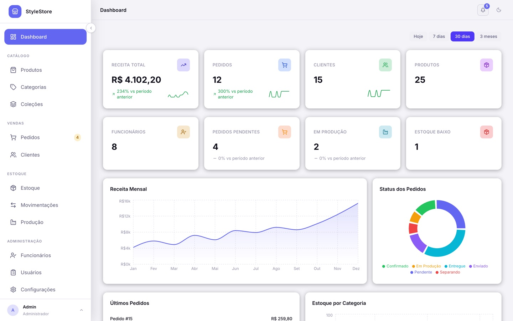
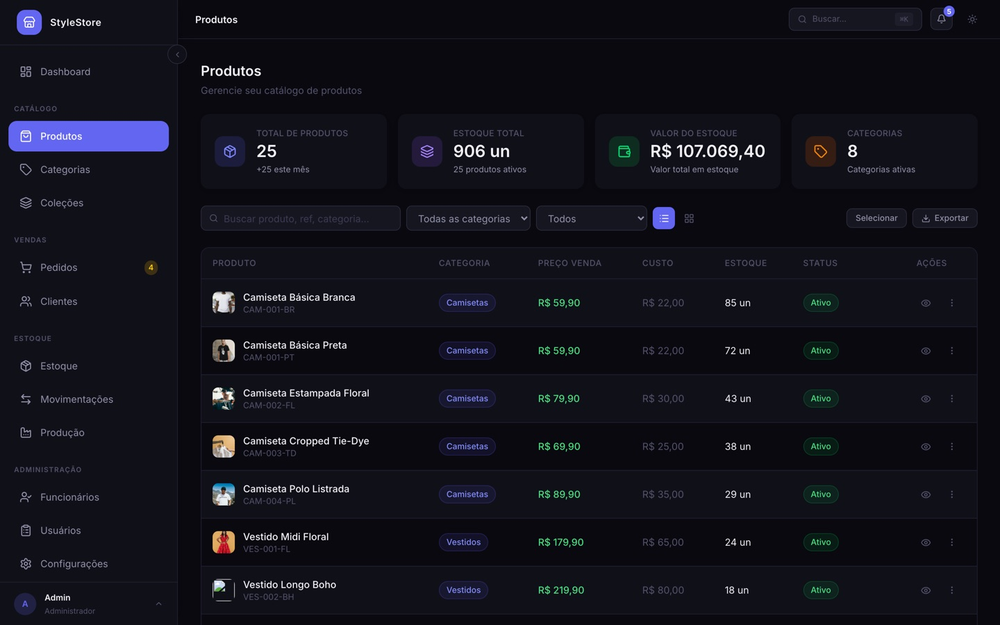
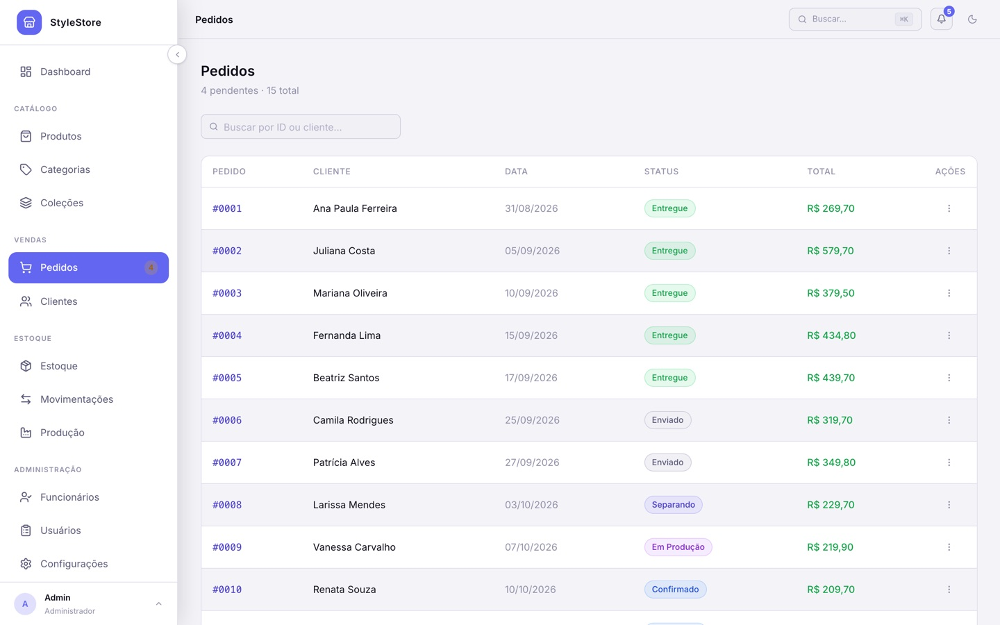
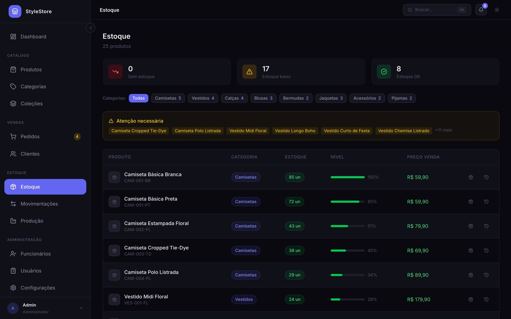
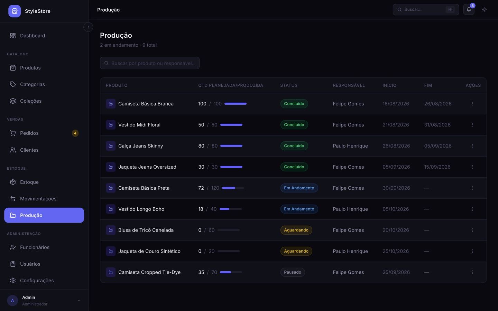
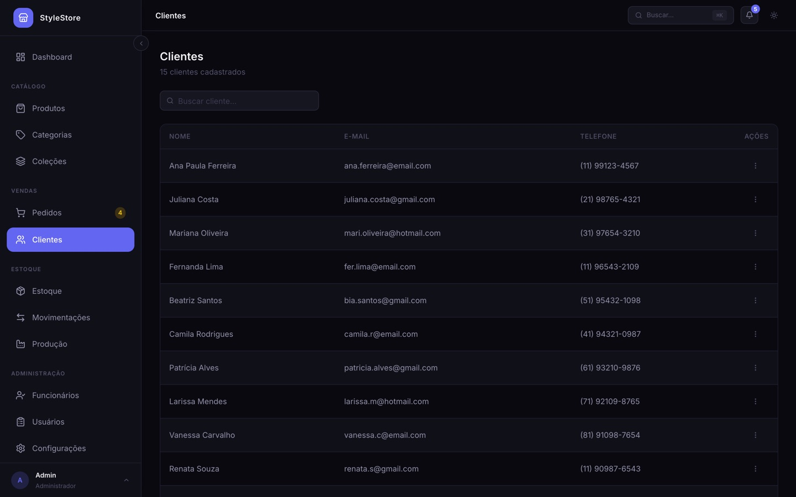

# StyleStore

Sistema administrativo que SIMULA uma loja de moda. Controla pedidos, produtos, clientes, funcionários, produção e estoque, com uma API em ASP.NET Core 8 e um painel em React 19.



## Telas

| Produtos | Pedidos |
|---|---|
|  |  |

| Estoque | Produção |
|---|---|
|  |  |

| Clientes |
|---|
|  |

## Tecnologias

### Back-end
| Tecnologia | Versão |
|---|---|
| .NET | 8.0 |
| ASP.NET Core (Web API) | 8.0 |
| Entity Framework Core | 8.0 |
| SQL Server (Azure SQL Edge) | latest |
| Swagger / OpenAPI | 6.6 |

### Front-end
| Tecnologia | Versão |
|---|---|
| React | 19 |
| Vite | 8 |
| TypeScript | 6 |
| Tailwind CSS | 4 |
| React Router | 7 |
| TanStack Query | 5 |
| Axios | 1 |
| Recharts | 3 |
| React Hook Form | 7 |
| Lucide React | 1 |

## Estrutura do projeto

```
StyleStore/
├── Controllers/           # Endpoints da API REST
├── Models/                # Entidades do banco de dados
├── Data/
│   ├── AppDbContext.cs    # Contexto do Entity Framework
│   └── Seeder.cs          # Dados de exemplo carregados na primeira execução
├── Migrations/            # Migrações do banco de dados
├── docs/                  # Documentação da API, decisões e design system
├── docker/                # Dockerfiles da API e do front
├── appsettings.json
├── appsettings.Development.json    # String de conexão (fora do git)
├── Program.cs
└── frontend/              # Aplicação React
    └── src/
        ├── components/
        │   ├── layout/    # Sidebar, TopBar, Layout
        │   └── ui/        # Button, Input, Modal, Table, Badge...
        ├── pages/         # Dashboard, Clientes, Produtos...
        ├── services/      # Chamadas à API (axios)
        └── types/         # Tipos TypeScript compartilhados
```

## Pré-requisitos

- [.NET 8 SDK](https://dotnet.microsoft.com/download)
- [Node.js 18+](https://nodejs.org)
- [Docker Desktop](https://www.docker.com/products/docker-desktop/) para rodar o SQL Server

## Como rodar

### 1. Banco de dados

O banco roda no Azure SQL Edge, via Docker. Escolha uma senha forte (no mínimo 8 caracteres, com maiúscula, minúscula, número e símbolo) e suba o container:

```bash
docker run -d --name sql_edge -e 'ACCEPT_EULA=1' -e 'MSSQL_SA_PASSWORD=SuaSenha' -p 1433:1433 mcr.microsoft.com/azure-sql-edge
```

Crie o `appsettings.Development.json` na raiz, com a mesma senha:

```json
{
  "ConnectionStrings": {
    "DefaultConnection": "Server=localhost,1433;Database=loja;User Id=sa;Password=SuaSenha;TrustServerCertificate=True"
  }
}
```

Ao iniciar, a API aplica as migrações e carrega dados de exemplo.

### 2. Back-end

```bash
dotnet run --environment Development
```

A API sobe em `http://localhost:5067`, com o Swagger em `http://localhost:5067/swagger`.

### 3. Front-end

```bash
cd frontend
npm install
npm run dev
```

O painel abre em `http://localhost:5173`.

### Com Docker Compose

Para subir banco, API e front de uma vez, copie `.env.example` para `.env`, defina `SA_PASSWORD` e rode:

```bash
docker compose up --build
```

## Módulos

| Módulo | O que faz |
|---|---|
| **Dashboard** | Indicadores, receita mensal, status dos pedidos, últimos pedidos e estoque por categoria |
| **Pedidos** | Cadastro, detalhe com itens e mudança de status (de Pendente a Entregue) |
| **Produtos** | Cadastro com categoria, preço de venda, custo, referência e alerta de estoque baixo |
| **Categorias** | Cadastro de categorias, com opção de ativar e inativar |
| **Clientes** | Cadastro e edição de clientes |
| **Funcionários** | Cadastro com cargo, salário, CPF e data de admissão |
| **Produção** | Ordens de produção com progresso, responsável e datas |
| **Estoque** | Visão consolidada com alertas de estoque zerado e baixo |
| **Movimentações** | Histórico de entradas e saídas do estoque |
| **Usuários** | Usuários do sistema |

### Status de pedido

| Status | Descrição |
|---|---|
| Pendente | Pedido recebido, aguardando confirmação |
| Confirmado | Pedido confirmado |
| Em Produção | Peças sendo produzidas |
| Separando | Pedido em separação no estoque |
| Enviado | Pedido despachado |
| Entregue | Entrega confirmada |
| Cancelado | Pedido cancelado |

### Status de produção

| Status | Descrição |
|---|---|
| Aguardando | Ordem criada, ainda não iniciada |
| Em Andamento | Produção em curso |
| Pausado | Produção interrompida |
| Concluído | Produção finalizada |
| Cancelado | Ordem cancelada |

## Endpoints da API

| Método | Rota | Descrição |
|---|---|---|
| GET/POST | `/api/clientes` | Listar e criar clientes |
| GET/PUT/DELETE | `/api/clientes/{id}` | Buscar, editar e excluir |
| GET/POST | `/api/produtos` | Listar e criar produtos |
| GET/POST | `/api/categorias` | Listar e criar categorias |
| GET/POST | `/api/funcionarios` | Listar e criar funcionários |
| GET/POST | `/api/pedidos` | Listar e criar pedidos |
| PATCH | `/api/pedidos/{id}/status` | Atualizar o status do pedido |
| GET/POST | `/api/producao` | Listar e criar ordens de produção |
| PATCH | `/api/producao/{id}/status` | Atualizar o status da produção |
| GET/POST | `/api/usuarios` | Listar e criar usuários |

A documentação completa está em [docs/API.md](docs/API.md).

## Diagrama de entidades

```
Categoria ──< Produto ──< ProdutoVariante
                │
                └──< ItemPedido >──┐
                                   │
Cliente ──< Pedido ──< ItemPedido  │
              │                    │
         Funcionario         Produto (ref)

Produto ──< Producao
```
