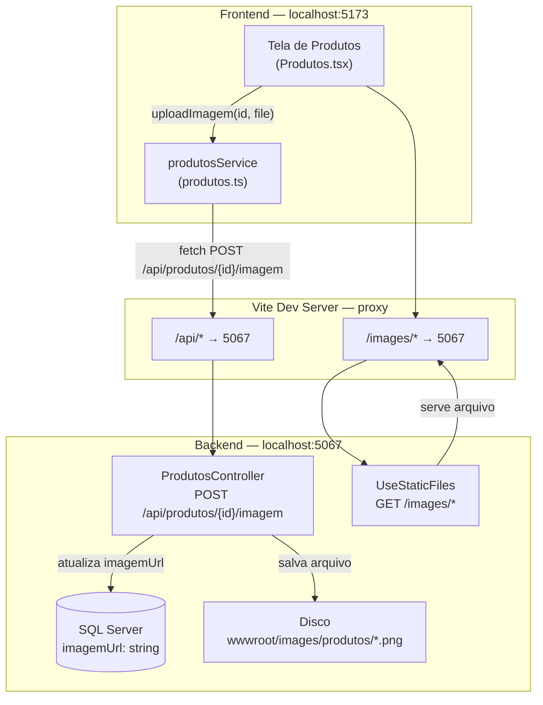
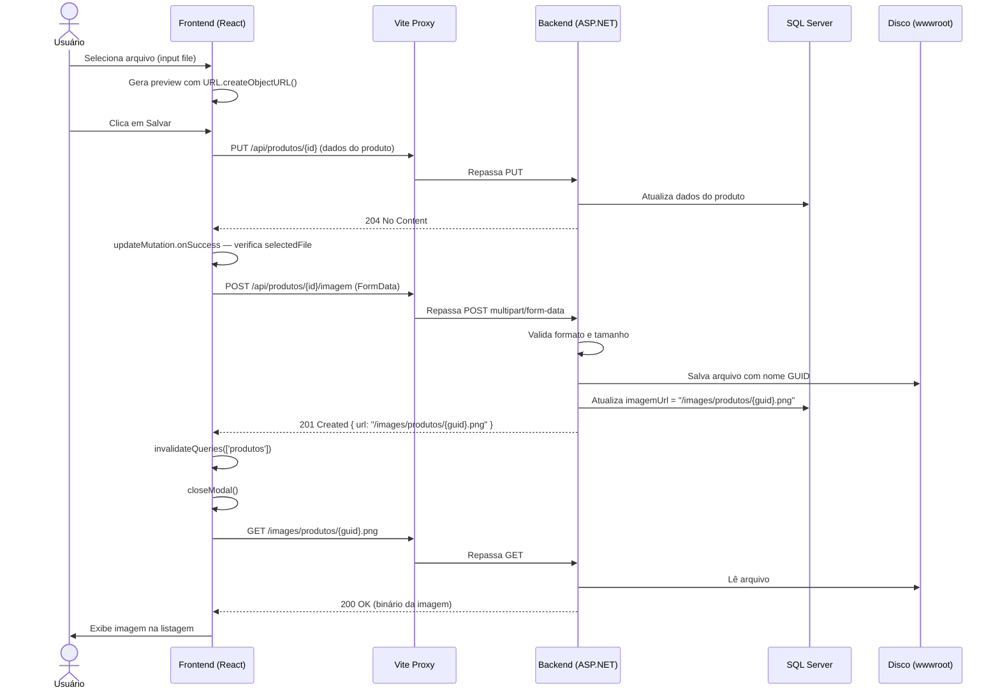
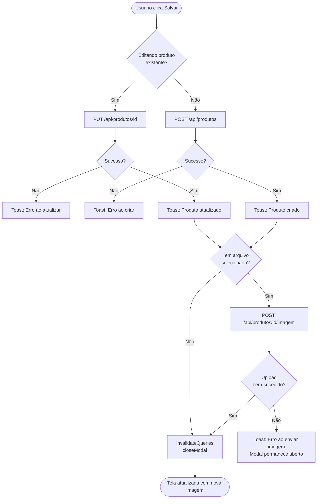
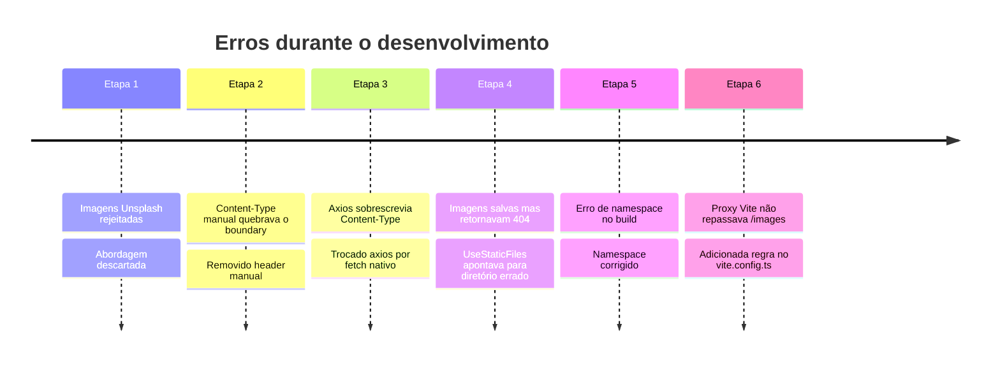
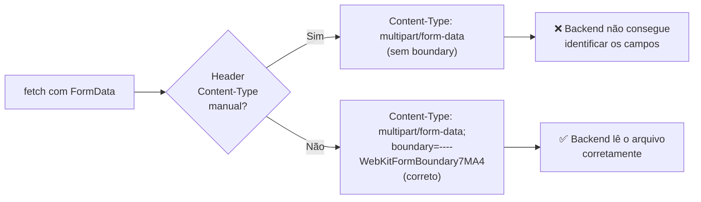
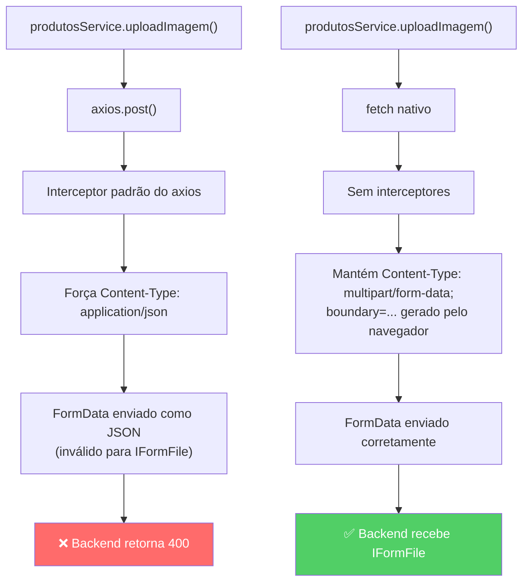
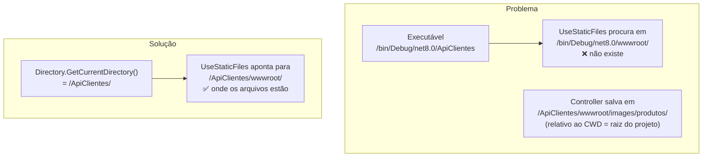
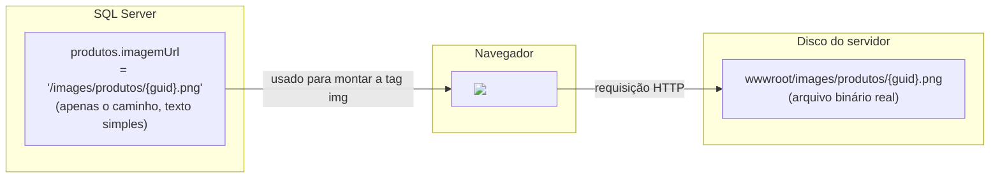

# Relatório Técnico — Upload de Imagens de Produtos

**Versão:** 2.0  
**Data:** 21/05/2026  
**Autor:** Andresa Lopes  
**Contexto:** Implementação do sistema de upload de imagens na tela de Produtos da StyleStore

---

## 1. Visão Geral

Este documento descreve a implementação completa do sistema de upload de imagens para produtos, os erros encontrados durante o desenvolvimento, as decisões técnicas tomadas e a solução final adotada.

---

## 2. Arquitetura do Sistema

### 2.1 Stack utilizada

| Camada | Tecnologia |
|---|---|
| Backend | ASP.NET Core 8 + Entity Framework Core 8 |
| Banco de dados | SQL Server (Azure SQL Edge via Docker) |
| Frontend | React 19 + TypeScript + Vite 5 |
| Estado assíncrono | TanStack Query 5 |
| Formulários | React Hook Form 7 |

### 2.2 Diagrama de arquitetura geral



---

## 3. Fluxo Completo de Upload

### 3.1 Sequência de operações



### 3.2 Fluxo de decisão no frontend



---

## 4. Erros Encontrados e Soluções

### 4.1 Linha do tempo dos erros



---

### Erro 1 — Abordagem inicial com URLs externas

**Sintoma:** Imagens de produtos exibidas via URLs do Unsplash.

**Problema:** As imagens não eram reais, não representavam os produtos da loja e dependiam de serviço externo.

**Decisão:** Descartar essa abordagem e implementar upload real de arquivos.

---

### Erro 2 — `Content-Type` manual quebrava o `boundary`

**Sintoma:** Backend recebia corpo inválido, upload falhava com 400.

**Causa raiz:**



**O que é o `boundary`:** É um separador gerado aleatoriamente pelo navegador que delimita cada campo do formulário no corpo da requisição. Ao setar o `Content-Type` manualmente, o boundary não é incluído e o servidor não sabe onde um campo termina e outro começa.

**Solução:** Nunca setar `Content-Type` manualmente ao enviar `FormData`.

---

### Erro 3 — Axios sobrescrevia o `Content-Type`

**Sintoma:** Dois toasts simultâneos — sucesso na atualização do produto + erro no upload. Modal não fechava.

**Causa raiz:** O axios possui um interceptor padrão que força `Content-Type: application/json` em todas as requisições POST. Mesmo sem setar manualmente, o axios substituía o header correto do `FormData`.



**Solução:** Usar `fetch` nativo exclusivamente para o upload:

```typescript
// services/produtos.ts
uploadImagem: async (id: number, file: File) => {
  const body = new window.FormData();
  body.append('arquivo', file);
  const res = await fetch(`/api/produtos/${id}/imagem`, { method: 'POST', body });
  if (!res.ok) throw new Error('Upload falhou');
  return res.json() as Promise<{ url: string }>;
},
```

---

### Erro 4 — Imagens salvas mas retornando 404

**Sintoma:** Upload concluía com sucesso (arquivo salvo no disco), mas a tag `` exibia erro 404 ao tentar carregar a imagem.

**Causa raiz — conflito de caminhos:**



**Por que o executável e o CWD são diferentes:**

Ao rodar o binário compilado diretamente (`bin/Debug/net8.0/ApiClientes`), o .NET define o `ContentRootPath` como o diretório do executável (`bin/Debug/net8.0/`). Mas o processo foi iniciado a partir da raiz do projeto, então o `Directory.GetCurrentDirectory()` retorna `/ApiClientes/`. O `UseStaticFiles()` sem parâmetros usa o `WebRootPath` derivado do `ContentRootPath` (o diretório do executável), não o CWD.

**Solução aplicada em `Program.cs`:**

```csharp
app.UseStaticFiles(new StaticFileOptions
{
    FileProvider = new PhysicalFileProvider(
        Path.Combine(Directory.GetCurrentDirectory(), "wwwroot")),
    RequestPath = "",
});
```

---

### Erro 5 — Namespace incorreto causou falha no build

**Sintoma:**
```
error CS0234: O nome de tipo ou namespace "StaticFileOptions" não existe
no namespace "Microsoft.AspNetCore.StaticFiles"
```

**Causa:** `StaticFileOptions` pertence ao namespace `Microsoft.AspNetCore.Builder`, não `Microsoft.AspNetCore.StaticFiles`.

**Solução:** Correção do namespace:
```csharp
// ❌ Errado
new Microsoft.AspNetCore.StaticFiles.StaticFileOptions

// ✅ Correto
new Microsoft.AspNetCore.Builder.StaticFileOptions
```

---

### Erro 6 — Vite Proxy não repassava `/images`

**Sintoma:** Imagens carregadas com 404 no browser mesmo após correção do backend. O backend servia corretamente em `localhost:5067/images/...`, mas o frontend em `localhost:5173` não encontrava.

**Causa:** O Vite Dev Server atua como proxy reverso apenas para as rotas configuradas. A rota `/images` não estava configurada.

**Solução em `vite.config.ts`:**

```typescript
proxy: {
  '/api': {
    target: 'http://localhost:5067',
    changeOrigin: true,
  },
  '/images': {                        // ← adicionado
    target: 'http://localhost:5067',
    changeOrigin: true,
  },
},
```

---

## 5. Estrutura de Arquivos Relevantes

```
ApiClientes/
├── Controllers/
│   └── ProdutosController.cs       # Endpoint POST /{id}/imagem
├── Program.cs                      # UseStaticFiles com PhysicalFileProvider
├── frontend/
│   ├── vite.config.ts              # Proxy /api e /images
│   └── src/
│       ├── pages/
│       │   └── Produtos.tsx        # ImagemUploadField + uploadMutation
│       └── services/
│           └── produtos.ts         # uploadImagem usando fetch nativo
└── wwwroot/
    └── images/
        └── produtos/
            └── {guid}.png          # Arquivos salvos aqui
```

---

## 6. Onde cada coisa é armazenada



> **Importante:** imagens nunca são gravadas no banco de dados como binário (BLOB). Isso seria péssima prática — tornaria o banco lento e muito pesado. O padrão correto é guardar o arquivo em disco (ou serviço de cloud como AWS S3) e registrar apenas o caminho no banco.

---

## 7. Especificações de imagem aceitas pelo sistema

| Propriedade | Valor |
|---|---|
| Formatos aceitos | JPG, JPEG, PNG, WEBP |
| Tamanho máximo | 5 MB |
| Dimensões recomendadas | 1024 × 1024 px (quadrado) |
| Validação de formato | Verificada pela extensão do arquivo no backend |
| Validação de tamanho | Verificada no frontend (antes do envio) e no backend |

---

## 8. Pontos de atenção para produção

1. **As imagens ficam no disco local.** Em produção, o ideal é migrar para um serviço de armazenamento em nuvem (ex: AWS S3, Azure Blob Storage) para garantir persistência e escalabilidade.
2. **Sem autenticação no endpoint de upload.** Qualquer pessoa com acesso à API pode enviar imagens. Em produção, proteger com autenticação/autorização.
3. **Limpeza de arquivos órfãos.** Se um produto for excluído, o arquivo de imagem permanece no disco. Uma rotina de limpeza seria necessária em produção.
